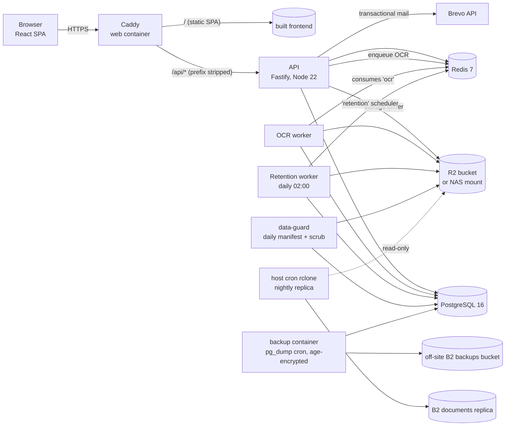

# 01 — Architecture

## 1. What the system is

A browser SPA talks to one HTTP API. Two background workers do slow or scheduled work. PostgreSQL holds all
data; Redis holds queues and login counters; files live in a pluggable storage backend (Cloudflare R2 or a NAS
mount). Everything is multi-tenant by **organization**, and inside an organization access is decided per
**department** by a single permission engine.



| Process | Entry point | Run with (dev) | Prod service |
|---|---|---|---|
| API | `backend/src/index.ts` → `buildApp()` in `app.ts` | `npm run dev --workspace backend` | `api` |
| OCR worker | `backend/src/worker/ocr.worker.ts` | `npm run worker:dev --workspace backend` | `worker` |
| Retention worker | `backend/src/worker/retention.worker.ts` | `npm run worker:retention:dev --workspace backend` (or `retention:run-once`) | `retention-worker` |
| Migrations | `prisma migrate deploy` | `npm run prisma:migrate --workspace backend` (dev) | `migrate` (one-shot, before api/workers) |
| Web | `frontend/` (Vite) | `npm run dev --workspace frontend` | `web` (Caddy serving the build + proxying `/api`) |
| Backup | `deploy/backup/` | — | `backup` (cron `pg_dump` → verify → `age` → off-site) |
| Data guard | `backend/src/worker/data-guard.ts` | `npx tsx src/worker/data-guard.ts --once` (with `DATA_GUARD_DIR` set) | `data-guard` (daily manifest + checksum scrub) |
| Uptime | Uptime Kuma | — | `uptime-kuma` (only with `--profile monitoring`, bound to 127.0.0.1:3001) |

## 2. Technology

| Layer | Choice | Version (package.json) |
|---|---|---|
| Runtime | Node.js | 22 (Docker `node:22-bookworm-slim`, CI 22) |
| HTTP | Fastify + `@fastify/cors`, `cookie`, `multipart`, `rate-limit` | fastify 5 |
| Validation | zod | 4.6.7 |
| ORM / DB | Prisma → PostgreSQL | prisma 6.19, Postgres 16 |
| Queue | BullMQ on Redis (ioredis) | bullmq 5, Redis 7 |
| Auth | jsonwebtoken (HS256 access JWT) + opaque refresh tokens; argon2id passwords | — |
| Storage | `@aws-sdk/client-s3` (R2) or `node:fs` (NAS), behind `StorageDriver` | — |
| OCR | pdf-parse (PDF text, always); tesseract.js (images, only when `OCR_IMAGES_ENABLED=true` — off in production) | tesseract.js 7, pdf-parse 2 |
| Mail | Brevo transactional API over `fetch` (console fallback) | — |
| Frontend | React + TypeScript + Vite, React Router, TanStack Query, Zustand, Tailwind; react-markdown + remark-gfm (safe Markdown preview) | React 19, Router 7, Query 5, Zustand 5, Tailwind 3, Vite 6, react-markdown 10.1.0, remark-gfm 4.0.1 |
| Reverse proxy | Caddy (TLS, security headers, static files) | 2.8 |

Reasoning for each choice: `docs/DMS_Technology_Stack.md`.

## 3. Repository map

```
<repo root>/                 (checked out at C:/apps/DMS on the dev machine)
├── package.json                npm workspaces: backend, frontend
├── docker-compose.yml          dev: postgres (host 5433) + redis (6379) only
├── docker-compose.prod.yml     prod: web, api, worker, retention-worker, data-guard, migrate, postgres, redis, backup, uptime-kuma
├── .env.example                dev env template (copy to .env at repo root)
├── .env.production.example     prod env template
├── .github/workflows/ci.yml    lint, typecheck, build, migrations, isolation suites
├── deploy/
│   ├── Caddyfile               TLS, headers, /api proxy, SPA fallback
│   ├── README.md               short ops notes
│   └── backup/                 backup image: backup.sh, restore.sh, entrypoint.sh
├── docs/                       product docs + this guide + API reference
├── backend/
│   ├── Dockerfile              build (tsc) → runtime (node user, dist/)
│   ├── prisma/
│   │   ├── schema.prisma       the schema (mirrors docs/DMS_Data_Model.md)
│   │   ├── migrations/         SQL migrations (+ down.sql for the risky ones)
│   │   └── seed.ts             seeds signup_setting
│   ├── scripts/                check-*.ts test suites, fixtures, db-mark-disposable
│   └── src/
│       ├── index.ts            process entry: loadEnv, prisma, redis, buildApp, listen
│       ├── app.ts              Fastify instance, plugins, route registration, error handler
│       ├── config/env.ts       zod-validated environment (fails fast)
│       ├── plugins/authenticate.ts   authenticate / requireX / requirePermission guards
│       ├── lib/                cross-cutting: permission engine, audit, crypto, jwt, queue, …
│       ├── modules/<name>/     <name>.routes.ts · <name>.service.ts · <name>.schemas.ts
│       └── worker/             ocr.worker.ts, retention.worker.ts
└── frontend/
    ├── Dockerfile              vite build → caddy image
    └── src/
        ├── main.tsx, App.tsx   QueryClient, router, routes
        ├── store/authStore.ts  Zustand session store
        ├── lib/                typed API clients per domain (api.ts = fetch + refresh)
        ├── pages/              one component per route
        ├── components/         shared UI (dialogs, shells, editors, pickers)
        └── routes/ProtectedRoute.tsx
```

## 4. Backend layering

```
HTTP request
  → Fastify plugins (cors, cookie, rate-limit, multipart)
  → route preHandlers: authenticate → requireVerifiedEmail → requireOrganization → [requireSuperAdmin] → [requirePermission(key)]
  → route handler: parse body/query with zod, build `actor`, call the service
  → service: business rules, tenant-scoped Prisma queries, permission-engine calls, audit logging
  → lib: permission engine, legal-hold, storage driver, search-vector, document-ref, audit, queue
  → Prisma / Redis / storage driver
  ← service throws <Module>Error(status, code, message) on refusal
  ← route returns JSON; app.setErrorHandler maps ZodError → 400, <Module>Error → its status, Fastify 4xx → as is, rest → 500
```

Conventions every module follows:

- **Three files per module**: `*.routes.ts` (HTTP only: guards, parsing, status codes), `*.service.ts`
  (all logic; framework-free so the check scripts can call it directly), `*.schemas.ts` (zod) — small modules
  keep schemas inline in the routes file.
- **`deps` objects** instead of globals: services take `{ prisma }`, `{ prisma, env }` or
  `{ prisma, redis, env }` as the first argument. The check scripts pass their own.
- **`actor`** = `{ userId, organizationId, isSuperAdmin }` (`PermissionActor`), built by each routes file's
  `actorFrom(request)` from the verified token. Services never read the request.
- **One error class per module** (`DocumentError`, `FolderError`, …) with `(statusCode, code, message)`; the
  global error handler in `app.ts` knows them all. Add a new module's error class there.
- **Audit is written by the service** after the state change succeeds (`lib/audit.ts logAuditEvent`).

## 5. The request lifecycle in detail

1. **`index.ts`** loads and validates env (`config/env.ts` — exits on any invalid value), creates the Prisma
   client and a Redis client, calls `buildApp(env, prisma, redis)` and listens on `PORT` (4000).
2. **`buildApp`** (`app.ts`) creates Fastify with `trustProxy: env.TRUST_PROXY` (so `request.ip` is the real
   client behind Caddy), decorates `app.env` and `app.prisma`, registers CORS (`CORS_ORIGIN`, credentials),
   cookies, rate-limit (`global: false`), multipart (`fileSize: MAX_UPLOAD_BYTES, files: 1, fields: 25`), the
   authenticate plugin, then every route plugin with its prefix (see the [API index](../API_Reference.md#3-endpoint-index)).
3. **Guards** run as `preHandler`s (`plugins/authenticate.ts`):
   - `authenticate` verifies the JWT, then re-checks **live state**: account active, still owner/active member
     of the token's org, and re-derives `isSuperAdmin` from `organization.createdByUserId`
     (SECURITY_AUDIT M-2). Two indexed lookups per request.
   - `requirePermission(key, extractor?)` resolves the engine for `(departmentId, folderId)` taken from params
     or body (or a custom extractor) and stores the result on `request.effectivePermissions`.
4. **Handler → service → response.** Domain errors become `{ error, message }` with their status.

## 6. Cross-cutting subsystems (where they live)

| Concern | File | Summary |
|---|---|---|
| Permission engine | `lib/effective-permissions.ts` | The **only** place permissions are resolved. See chapter 04. |
| Permission catalogue | `lib/permissions.ts` | Fixed key set, dependencies, Department-Admin capability. |
| Share access | `lib/share-access.ts` | A recipient's view/download floor via an active share. |
| Legal Hold | `lib/legal-hold.ts` | Which holds cover a document/folder; who may place/remove them. |
| Audit | `lib/audit.ts` | `logAuditEvent` (create only), auto-flags confidential events, `SYSTEM_ACTOR`. |
| Document IDs | `lib/document-ref.ts` | `DEPT-TYPE-YYYY-NNNNN` from `document_ref_sequence`, inside the create transaction. |
| Search index | `lib/search-vector.ts` | Recomputes `document.searchVector` (weighted tsvector). |
| Upload formats | `lib/upload-formats.ts` | Accepted formats, content detection (magic bytes / OOXML directory). |
| Upload concurrency | `lib/upload-limiter.ts` | Per-process and per-user upload slots. |
| Storage | `modules/storage/*` | `StorageDriver` interface, NAS + R2 drivers, target policy, encrypted credentials. |
| Queue | `lib/queue.ts` | BullMQ queues `ocr` and `retention`; best-effort `enqueueOcr`. |
| Crypto | `lib/crypto.ts` | AES-256-GCM for storage credentials (`STORAGE_CREDENTIALS_KEY`). |
| Tokens | `lib/tokens.ts`, `lib/jwt.ts`, `lib/password.ts` | 256-bit tokens (hash stored), JWT sign/verify, argon2id. |
| Calendar | `lib/calendar.ts` | Org-time-zone date maths for Upload Date filters and retention. |
| Mail | `lib/mailer.ts` | Brevo with retries on network errors; console fallback; `MAIL_DISABLED`. |
| Rate limits | `lib/rate-limits.ts` | `sensitive`, `login`, `publicRead` profiles. |

## 7. Deliberate decisions that differ from a first reading of the docs

These were decided by the product owner and are recorded in code comments — do not "fix" them:

| Decision | Where | Effect |
|---|---|---|
| The **Super Admin is not a reader** of departments by default | `effective-permissions.ts` `SUPER_ADMIN_ADMINISTRATIVE_KEYS` | Without a membership, the owner can administer (members, roles, config, audit) but not open documents. Reading always leaves a membership as a record. |
| The **department creator is not auto-added** as a member | `department.service.ts createDepartment` | A new department can start with zero members. |
| The Super Admin **can't add themself** to a department (a Department Admin can add them) | `listAddableMembers` | Granting access is always someone else's act. |
| **Confidential named members without a department role get a read floor** (view, preview, download, version history, search) | `CONFIDENTIAL_FLOOR` | Being on the list always means something. |
| **Only the vault owner manages the named list** | `confidential.service.ts requireVaultOwner` | Decided 2026-11-07 (SECURITY_AUDIT M-6). |
| External links are **suspended, not revoked**, when their conditions lapse | `sharing.service.ts resolveLink` | Restoring the condition restores the link. |
| Every department gets a **"General"** folder on creation | `createDepartment` | Members can upload immediately. |

## 8. Where to go next

- Data: [03 Database schema](03_Database_Schema.md)
- Who can do what: [04 Security & permissions](04_Security_and_Permissions.md)
- Every module: [05 Backend modules](05_Backend_Modules.md)
