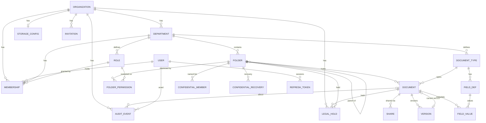

# 03 — Database schema

PostgreSQL 16, managed by Prisma. **Source of truth:** `backend/prisma/schema.prisma` plus the raw SQL in
`backend/prisma/migrations/*/migration.sql` (constraints and triggers Prisma can't express). The schema mirrors
`docs/DMS_Data_Model.md` and uses its names.

Naming: models are PascalCase and mapped to snake_case **table** names (`@@map("audit_event")`), but **column
names are the camelCase field names** (`"organizationId"`, `"uploadedAt"`), so raw SQL must double-quote them.

## 1. Entity-relationship overview

Organization ownership is `organization.createdByUserId` (the **Super Admin**); the owner has **no**
membership row unless someone gives them one.

## 2. Tables

Legend: **PK** primary key · **FK** foreign key · **UQ** unique · **IX** index · ⚠ = an invariant you must keep.

### 2.1 Tenancy and identity

#### `organization`
| Column | Type | Notes |
|---|---|---|
| id | uuid PK | |
| name | text | |
| industry | text? | |
| subfolderDepthLimit | int, default 5 | Default folder nesting limit (a department may override). |
| timeZone | text, default `Asia/Kolkata` | IANA zone. **CHECK** `organization_timeZone_valid`: must be a zone Postgres knows. Defines "today" for retention and the Upload Date filter. |
| createdByUserId | uuid | The owner = **Super Admin** (no FK constraint in Prisma). |
| createdAt, updatedAt | timestamp | |

#### `user` — the only table without `organizationId` (global identity)
| Column | Type | Notes |
|---|---|---|
| id | uuid PK | |
| email | text **UQ** | Lower-cased by the API. |
| passwordHash | text | argon2id. |
| fullName | text | |
| emailVerifiedAt | timestamp? | null = unverified. |
| status | `UserStatus` (`active`/`disabled`), default active | Global. Checked at login, refresh and on **every request**. No API sets it (only direct DB). |
| createdAt, updatedAt | | |

#### `membership` — user × department × role (the join that defines access)
| Column | Type | Notes |
|---|---|---|
| id | uuid PK | |
| organizationId | uuid FK → organization | |
| userId | uuid FK → user | |
| departmentId | uuid FK → department | |
| roleId | uuid FK → role | |
| status | `MembershipStatus` (`active`/`invited`/`disabled`) | Only `active` grants anything. Org-wide disable flips every membership in that org. |
| invitedEmail | text? | Set when created from an invitation. |
| createdAt, updatedAt | | |

⚠ **UQ `(userId, departmentId)`** — one role per user per department (hard rule).

### 2.2 Departments, roles, schema

#### `department`
| Column | Type | Notes |
|---|---|---|
| id | uuid PK | |
| organizationId | uuid FK | |
| name | text | Unique per org (app-enforced). |
| idPrefix | text | `DEPT` segment of document IDs, `^[A-Z0-9]{2,8}$`, unique per org (app-enforced). Changing it never rewrites existing IDs. |
| subjectTerm, identifierTerm | text? | Vocabulary ("Employee", "Employee ID"). |
| subfolderDepthLimit | int? | null = use the org default. |
| rules | jsonb? | `{ "defaultSharing": { "externalLinksEnabled": bool, "linkExpiryDays": 1–365 } }`; null = defaults (links off, 7 days). |
| autoDeleteYears | int? | Auto-delete period; null = off. **CHECK** `department_autoDeleteYears_positive`: null or 1–100. |
| status | `DepartmentStatus` (`active`/`archived`) | |
| createdAt, updatedAt | | |

#### `role`
| Column | Type | Notes |
|---|---|---|
| id | uuid PK | |
| organizationId | uuid | |
| departmentId | uuid FK → department | Roles are per department, never global. |
| name | text | Unique per department (app-enforced). |
| isSystem | bool | Built-ins (template "Department Admin", "Staff") can't be deleted. |
| permissions | jsonb | `{ "<permission key>": true/false, … }` — the **full** catalogue map after dependency closure. See chapter 04. |
| createdAt, updatedAt | | |

#### `document_type`
| Column | Type | Notes |
|---|---|---|
| id | uuid PK | |
| departmentId | uuid FK | No `organizationId` of its own — always reached through its department. |
| name | text | Unique per department. |
| idCode | text | `TYPE` segment of document IDs, `^[A-Z0-9]{1,8}$`, unique per department. |

#### `field_def`
| Column | Type | Notes |
|---|---|---|
| id | uuid PK | |
| documentTypeId | uuid FK | |
| label | text | Unique within the type. |
| fieldType | `FieldType`: `text`, `id`, `dropdown`, `date`, `number`, `person` | Drives the upload form, the filter control and validation. |
| isRequired | bool | Missing required values don't block upload — the doc goes to "needs details". |
| isFilterable | bool, default true | Shown in the search filter panel. |
| isTitle | bool | ⚠ exactly **one** per type (app-enforced); its value becomes `document.titleValue`. |
| options | jsonb? | `string[]`, dropdown only. |
| sortOrder | int | = position in the editor array. |

### 2.3 Folders and documents

#### `folder`
| Column | Type | Notes |
|---|---|---|
| id | uuid PK | |
| organizationId, departmentId | uuid | ⚠ A folder is only ever evaluated against **its own** department (SECURITY_AUDIT H-1). |
| parentFolderId | uuid? FK → folder | null = department root. |
| name | text | Unique among siblings (app-enforced). |
| isConfidential | bool | ⚠ Flows down: every descendant of a confidential folder is confidential, and can't be downgraded. The named list lives on the topmost confidential folder of a branch. |
| depth | int | Root = 0. Maintained on create/move. |

#### `folder_permission` — restrictive override
| Column | Type | Notes |
|---|---|---|
| id | uuid PK | |
| folderId | uuid FK | |
| roleId | uuid FK | |
| permissions | jsonb | Map of keys; a key that is `false` (or missing) is **withheld** on this folder and its subtree. ⚠ Can only take away (the engine intersects). |

UQ `(folderId, roleId)`. Not allowed on confidential folders.

#### `document` — identity + metadata (bytes live in `version`)
| Column | Type | Notes |
|---|---|---|
| id | uuid PK | |
| organizationId, departmentId, folderId, documentTypeId | uuid | |
| documentRef | text | `DEPT-TYPE-YYYY-NNNNN`. ⚠ **Immutable**, never reused, shared by every version. **UQ `(organizationId, documentRef)`**. |
| titleValue | text? | Copy of the title field's value. |
| currentVersionId | uuid? **UQ** FK → version | |
| status | `DocumentStatus` (`active`/`in_trash`) | |
| workflowState | `WorkflowState`? | Reserved for Release 2 — do not use, do not drop. |
| deletedAt, deletedByUserId | timestamp?, uuid? | Set when trashed (null deleter = the System). Cleared on restore. |
| trashSource | `TrashSource`? (`user`/`auto_delete`) | How it reached the trash. |
| trashReason | text? | e.g. "Auto-deleted - retention period ended". |
| uploadedAt | timestamp, default now() | ⚠ **Immutable** — the auto-delete clock. **Trigger** `document_uploaded_at_immutable` rejects any change. |
| searchVector | tsvector (Unsupported in Prisma) | Full-text index, written only by raw SQL (`lib/search-vector.ts`). **GIN IX**. |
| createdAt, updatedAt | | `updatedAt` drives the default search order. |

IX `(departmentId, status, uploadedAt)` — the daily auto-delete scan and the Upload Date filter.

#### `document_ref_sequence` — numbering for document IDs
PK `(organizationId, departmentId, documentTypeId, year)`, `lastNumber int`. Incremented by an upsert inside the
document-create transaction (`lib/document-ref.ts`), so a rolled-back create never leaves a gap.

#### `version`
| Column | Type | Notes |
|---|---|---|
| id | uuid PK | |
| organizationId, documentId | uuid | |
| versionNumber | int | **UQ `(documentId, versionNumber)`**. ⚠ Versions are never overwritten; restoring copies forward as a new number. |
| storageRef | text | Opaque key into the storage backend (`<orgId>/<uuid>`). A restored version reuses the same ref. |
| fileName, fileSize, mimeType | | `mimeType` is the **detected** format (not what the client claimed). |
| checksum | text? | SHA-256 hex. **IX `(organizationId, checksum)`** for duplicate detection. |
| ocrStatus | `OcrStatus` (`pending`/`done`/`failed`) | Office files are `done` immediately (no OCR). Markdown / plain-text files are `done` at upload with their text stored. |
| ocrText | text? | ≤ 1,000,000 chars. For Markdown / plain text it is the file's own text. |
| changeNote | text? | |
| uploadedByUserId | uuid FK → user | |
| createdAt | | |

#### `field_value`
`id`, `documentId` FK, `fieldDefId` FK, `value text`. **UQ `(documentId, fieldDefId)`**. Stored as strings:
dates `YYYY-MM-DD`, numbers as decimal text, dropdown = one of the options.

### 2.4 Sharing, confidential, legal hold

#### `share`
| Column | Type | Notes |
|---|---|---|
| id | uuid PK | |
| organizationId, documentId, sharedByUserId | uuid | ⚠ Points at the original document — never a copy. |
| targetType | `ShareTargetType`: `user`, `department`, `external_link` | |
| targetUserId / targetDepartmentId | uuid? | Per type. |
| permission | `SharePermission`: `view`, `download` | |
| linkToken | text? **UQ** | SHA-256 of the external-link token (raw token only in the URL). |
| expiresAt | timestamp? | Mandatory for links. Access checks treat a passed `expiresAt` as expired; expired `active` rows are **deleted** by a lazy sweep whenever a share list loads (`purgeExpiredShares`). |
| status | `ShareStatus`: `active`, `pending` (cross-dept awaiting consent), `revoked`, `expired` | |
| openedCount | int | External-link opens. |
| dismissedAt | timestamp? | Recipient hid it from their inbox (access unchanged). |

#### `confidential_member` — the named list
`id`, `folderId` FK, `userId` FK, `isOwner bool`. **UQ `(folderId, userId)`**. ⚠ The owner can't be removed;
only the owner adds/removes members.

#### `confidential_recovery` — dual-control reopening of an orphaned vault
`id`, `organizationId`, `folderId` FK (IX), `newMemberUserId`, `initiatedByUserId`, `superAdminApprovedByUserId?`,
`deptAdminApprovedByUserId?`, `status` (`pending`/`completed`/`cancelled`), `createdAt`, `completedAt?`.

#### `legal_hold`
| Column | Type | Notes |
|---|---|---|
| id | uuid PK | |
| organizationId FK, departmentId FK | | |
| documentId? / folderId? | uuid FK (**ON DELETE RESTRICT**) | **CHECK** `legal_hold_one_target`: exactly one is set. A folder hold covers the whole subtree. |
| reason | text | **CHECK** `legal_hold_reason_present`: not blank. ≤ 500 chars (app). |
| placedByUserId, placedAt | | |
| removedByUserId?, removedAt? | | null = active. **CHECK** `legal_hold_removal_complete`: both or neither. Rows are kept after removal. |

Partial **UQ** indexes: one *active* hold per document (`legal_hold_active_document_key`) and per folder
(`legal_hold_active_folder_key`), `WHERE "removedAt" IS NULL`. IX on `(organizationId, departmentId)`,
`documentId`, `folderId`.

### 2.5 Audit

#### `audit_event` — append-only
| Column | Type | Notes |
|---|---|---|
| id | uuid PK | |
| organizationId | uuid FK (RESTRICT) | |
| actorUserId | uuid? FK → user (**ON DELETE RESTRICT**) | null only for system events. **CHECK** `audit_event_actor_matches_type`: `actorType = 'system'` ⇔ `actorUserId IS NULL`. |
| actorType | `AuditActorType` (`user`/`system`) | |
| action | `AuditAction` | 18 values — see API reference §16. |
| documentId | uuid? FK → document (**ON DELETE SET NULL**) | So a purge keeps the trail; the doc ref survives in `targetDescription`. |
| targetDescription | text? | Human sentence, includes the document ref. |
| departmentId | uuid? | |
| isConfidential | bool | Set automatically for events about documents in confidential folders. |
| occurredAt | timestamp | |

⚠ **Triggers** `audit_event_append_only_row` (BEFORE UPDATE OR DELETE, per row) and
`audit_event_append_only_truncate` (BEFORE TRUNCATE) — migration `20261107120000_audit_append_only`:
- Any UPDATE is refused, **except** the FK's own SET NULL: an update whose only change is `documentId` → NULL.
- DELETE and TRUNCATE are refused, **except** on a database marked disposable
  (`ALTER DATABASE … SET dms.audit_purge_allowed = 'on'`, read from `pg_db_role_setting`) **and** inside a
  transaction that ran `SELECT set_config('dms.audit_purge','on', true)`. Production is never marked.
- The test suites use `backend/scripts/_audit-purge.ts` for this. Application code never deletes audit rows.

### 2.6 Storage and platform

#### `storage_config` (one per organization in R1)
`id`, `organizationId` **UQ** FK, `backendType` (`nas`/`r2`), `credentials jsonb` = `{ "enc": "<base64 iv|tag|ciphertext>" }`
(AES-256-GCM of the connection JSON, key `STORAGE_CREDENTIALS_KEY`), `status` (`pending`/`verified`/`error`),
`lastTestedAt?`, `quotaBytes bigint?`, `usedBytes bigint` (incremented on upload and rolled back if the upload
fails; ⚠ **not** decremented when a document is purged — known gap, so the figure only grows; `quotaBytes` is
not enforced anywhere).

#### Auth tables
| Table | Columns | Notes |
|---|---|---|
| `refresh_token` | id, userId FK, tokenHash **UQ**, deviceInfo?, ipAddress?, expiresAt, revokedAt?, lastUsedAt?, createdAt | Rotated on each use; all revoked on password reset, logout-all, or refresh by a disabled account. |
| `password_reset_token` | id, userId, tokenHash UQ, expiresAt, usedAt?, createdAt | 60 min. |
| `email_verification_token` | id, userId, tokenHash UQ, expiresAt, usedAt?, createdAt | 24 h. |
| `invitation` | id, organizationId FK, departmentId, roleId, email, invitedByUserId FK, tokenHash UQ, status (`pending`/`accepted`/`expired`/`revoked`), expiresAt, createdAt | 7 days; resend rotates the token. |
| `signup_setting` | id = 1, mode (`open`/`invite_code`/`disabled`), updatedBy?, updatedAt | Single global row (seeded). |
| `signup_invite_code` | id, code UQ, maxUses?, usedCount, expiresAt?, active, createdAt | Managed by SQL — no API. |
| `login_attempt` | id, email, ipAddress?, succeeded, attemptedAt, userId? | **IX `(email, attemptedAt)`**. Backs the trusted-IP rule. Grows unbounded (no pruning yet). |

All tokens: 32 random bytes hex; only the SHA-256 is stored (`lib/tokens.ts`).

## 3. JSON column shapes

| Column | Shape |
|---|---|
| `role.permissions` | `Record<PermissionKey, boolean>` — every catalogue key present after `applyPermissionDependencies`. |
| `folder_permission.permissions` | Same shape; a key not `true` is withheld. |
| `department.rules` | `{ defaultSharing: { externalLinksEnabled: boolean, linkExpiryDays: number } }` |
| `field_def.options` | `string[]` |
| `storage_config.credentials` | `{ enc: string }` — decrypts to `{ backendType: "nas", mountPath, username?, password? }` or `{ backendType: "r2", endpoint, bucket, accessKeyId, secretAccessKey }` |

## 4. Full-text search vector

`document.searchVector` is a weighted `tsvector` (`english` config) rebuilt by
`refreshDocumentSearchVector(db, documentId)` after every create, metadata edit, new/restored version and OCR
completion:

| Weight | Source |
|---|---|
| A | `documentRef`, `titleValue` |
| B | all field values (space-joined), current version `fileName` |
| C | current version `ocrText` |

`refreshAllDocumentSearchVectors` backfills every row (run once after adding the column). Queries use prefix
terms (`inv:*`) and `ts_rank` — see `modules/search/search.service.ts`.

## 5. Migration history

| Migration | What it did |
|---|---|
| `20260721124139_init` | All base tables and enums. |
| `20260723123008_department_rules` | `department.rules` jsonb. |
| `20260724052444_version_checksum` | `version.checksum` + `(organizationId, checksum)` index (duplicate detection). |
| `20260724104538_document_search_vector` | `document.searchVector` tsvector + GIN index. |
| `20260725070508_share_dismissed` | `share.dismissedAt`. |
| `20260725080317_confidential_recovery` | `confidential_recovery` table + enum. |
| `20260725094824_document_trash` | `document.deletedByUserId`. |
| `20261030054602_retention_legal_hold` | PRD v1.2: `TrashSource`, `AuditActorType`, 5 new audit actions, nullable `actorUserId`, `department.autoDeleteYears`, `document.trashSource/trashReason`, `organization.timeZone`, `legal_hold`, the `uploadedAt` trigger, all CHECK constraints and partial indexes above, and granted the new `retention.*` keys to existing Department-Admin-capable roles. Has a `down.sql`. |
| `20261107120000_audit_append_only` | Append-only triggers on `audit_event` (SECURITY_AUDIT M-1). Has a `down.sql`. |

### Writing a migration

1. Edit `schema.prisma`, then `npm run prisma:migrate --workspace backend` (dev) — Prisma generates SQL.
2. For anything Prisma can't express (CHECK, trigger, partial index, data backfill), create an empty migration
   with `npx dotenv -e ../.env -- prisma migrate dev --create-only --name <name>` and write the SQL by hand.
3. For risky changes add a `down.sql` next to `migration.sql` (see the two existing ones for the pattern).
4. Production applies migrations with `prisma migrate deploy` (the `migrate` service) before api/workers start.
5. Update `docs/DMS_Data_Model.md` and this chapter.

⚠ Never rename a permission key or enum value that already has rows; never drop `workflowState`; never add an
update/delete path to `audit_event`; never write `document.uploadedAt` after insert.

## 6. Tenant-isolation checklist for queries

- Every `findMany/findFirst/count/update/delete` on a tenant table includes `organizationId: actor.organizationId`.
- A department or folder id from a request is **never trusted alone** — pair it with the org (and, for folders,
  with the URL's department).
- `document_type` and `field_def` have no `organizationId`; reach them through `departmentId` (itself verified).
- Raw SQL (`$queryRaw`) must carry the same conditions and use Prisma's tagged templates (parameterised).
- `check:tenant-isolation` and `check:department-binding` exist to catch regressions — keep them green.
