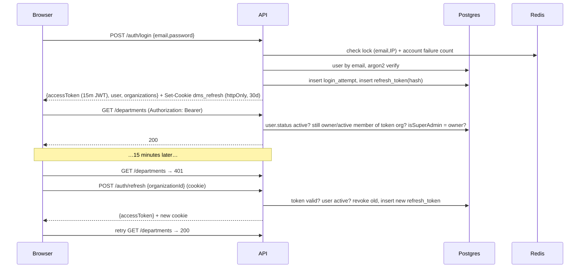

# 04 — Security & permissions

This chapter explains who can do what and how it is enforced. If you change anything here, run the security
suites (`check:access-matrix`, `check:tenant-isolation`, `check:department-binding`, `check:share-exposure`,
`check:role-escalation`, `check:member-hierarchy`, `check:link-revalidation`, `check:session-revocation`,
`check:login-lockout`, `check:vault-owner`, `check:confidential`) and read `SECURITY_AUDIT.md`.

## 1. Defence layers at a glance

| Layer | Mechanism | File |
|---|---|---|
| Transport | TLS (Caddy, ACME), HSTS, `nosniff`, `X-Frame-Options: SAMEORIGIN`, CSP `frame-ancestors/base-uri/form-action 'self'`, `Referrer-Policy`, `Permissions-Policy` | `deploy/Caddyfile` |
| Browser | CORS locked to `CORS_ORIGIN`; refresh token in an httpOnly, `SameSite=Lax`, `Secure` (prod) cookie; access token only in memory | `app.ts`, `auth.service.ts` |
| Abuse | Per-IP rate limits on public routes; login lockout per (email, IP) + per-account trusted-IP step-up; upload concurrency slots | `lib/rate-limits.ts`, `auth.service.ts login`, `lib/upload-limiter.ts` |
| Identity | argon2id passwords; 256-bit single-use tokens stored as SHA-256; HS256 JWT re-validated against live DB state on every request | `lib/password.ts`, `lib/tokens.ts`, `plugins/authenticate.ts` |
| Tenancy | `organizationId` on every query; department binding of folders | every service; `effective-permissions.ts` |
| Authorization | One permission engine; folder overrides restrict only; confidential named lists; "within reach" rules for roles and members | `lib/effective-permissions.ts`, `department.service.ts` |
| Information hiding | 404 for anything you may not see; query-layer exclusion of confidential/unviewable folders; response shaping by permission | services, `unviewableFolderIdsToExclude`, `document.service.ts shapeDocument` |
| Data | Storage credentials AES-256-GCM; uploads verified by content; storage targets allow-listed; audit append-only (DB trigger); `uploadedAt` immutable (DB trigger) | `lib/crypto.ts`, `lib/upload-formats.ts`, `storage.policy.ts`, migrations |

## 2. Authentication and sessions



Rules:
- **Register** creates an unverified user and a session; most business routes need `emailVerified`
  (`requireVerifiedEmail`). Verification links last 24 h; resend invalidates older ones.
- **Login** — identical `401 invalid_credentials` for unknown email and wrong password. A disabled account gets
  `403 account_disabled` (note: this is checked *before* the password, a known minor enumeration signal, L-4).
- **Lockout** (Redis keys `login:fail:<email>:<ip>`, `login:lock:<email>:<ip>`, `login:fail-account:<email>`):
  5 failures per (email, IP) lock that pair for 15 min; after 50 failures per account (all IPs) only IPs with a
  successful login in the last 30 days (from `login_attempt`) may try. A success clears only its own pair.
- **Access token claims are hints.** `authenticate` re-checks on every request: account active, user still the
  owner or an active member of the token's org, Super Admin = owner. So disabling an account or a membership
  takes effect at the next request, not when the token expires (SECURITY_AUDIT M-2).
- **Refresh** rotates the token every time; a disabled account's refresh revokes **all** its sessions.
- **Password reset** revokes all refresh tokens. **Logout-all** too.
- **Organization switch** = `select-organization` (new access token scoped to the other org).

## 3. The permission catalogue

Source: `lib/permissions.ts` (`PERMISSION_CATALOGUE`). Keys are `group.key` and **must never be renamed**
(role rows store them). Stored on `role.permissions` as a full boolean map.

| Key | Label | Requires | Enforced in | Template roles that have it |
|---|---|---|---|---|
| `documents.view` | View documents | — | engine, folders, documents, sharing, upload | all |
| `documents.upload` | Upload documents | — | upload route | DA, Staff, Manager |
| `documents.download` | Download documents | view | documents, sharing | DA, Staff, Manager |
| `documents.edit_metadata` | Edit metadata | view | documents | DA, Staff, Manager |
| `documents.delete` | Delete documents | view | documents (trash) | DA, Manager |
| `documents.restore` | Restore from trash | view | documents, trash list | DA, Manager |
| `documents.version_history` | View version history | view | documents (history, activity, old files) | DA, Staff, Manager, Auditor |
| `documents.preview` | Preview documents | view | documents (inline file) | DA, Staff, Manager, Auditor |
| `documents.upload_version` | Upload a new version | view | documents, upload | DA, Staff, Manager |
| `folders.create` / `rename` / `delete` / `move` | Folders | — | folder routes | create/rename: DA, Staff, Manager · delete/move: DA, Manager |
| `sharing.share` | Share documents | — | sharing | DA, Staff, Manager |
| `sharing.remove_share` | Remove a share | share | ⚠ **not enforced** (revoke is sharer self-service) | DA, Manager |
| `sharing.create_link` | Create a link | share | sharing, links | DA, Manager |
| `sharing.external_share` | External share | share | sharing, links | DA |
| `sharing.cross_department_share` | Cross-department share | share | sharing (send + receive consent) | DA, Manager |
| `search.search` | Search | — | search route | all |
| `search.advanced_search` | Advanced search | — | ⚠ **not enforced** | DA, Staff, Manager, Auditor |
| `audit.view_audit` | View audit log | — | audit | DA, Manager, Auditor |
| `audit.export_audit` | Export audit log | view_audit | audit export | DA |
| `audit.view_confidential_audit` | View confidential audit events | view_audit | audit (segregation) | DA |
| `members.invite` | Invite members | — | invitations, add member, addable list | DA, Manager |
| `members.remove` | Remove members | — | remove member | DA |
| `members.change_role` | Change member roles | — | roles CRUD, change role, dept settings read | DA |
| `configuration.create_document_type` / `edit_document_type` / `delete_document_type` | Document types | — | department service | DA |
| `configuration.edit_metadata_schema` | Edit metadata schema | — | ⚠ **not enforced** | DA |
| `configuration.edit_rules` | Edit rules | — | dept settings, folder overrides | DA |
| `retention.manage_auto_delete` | Manage auto-delete period | — | retention | DA |
| `retention.manage_legal_hold` | Place and remove legal holds | view | retention, legal-hold authority, restore of auto-deleted | DA |
| `retention.view_upcoming_deletions` | View upcoming deletions | view | retention | DA |
| `workflow.*` (approve, reject, request_changes, create_workflow) | Workflow | view (first three) | Release 2 — inactive | none |
| `search.saved_searches`, `reports.view_reports`, `reports.export_reports` | — | — | Release 2 — inactive | none |

DA = template "Department Admin" (every R1-active key). Staff / Manager / Auditor = `STAFF_KEYS`,
`MANAGER_KEYS`, `AUDITOR_KEYS` in `department.templates.ts`; templates name the manager role per sector
(HR Manager, Finance Manager, Registrar, Legal Counsel, Medical Records Officer).

**Dependencies** (`PERMISSION_DEPENDENCIES`): a child key needs its parents. The API **refuses** an invalid map
(`400 invalid_permissions`) and stores the dependency closure; the UI auto-ticks parents as you tick children.

**Department-Admin capability** (`hasDepartmentAdminCapability`) = `members.change_role` **and**
`configuration.edit_rules`. Guardrails: a department must keep at least one admin-capable role
(`no_department_admin_role`), and once members exist, at least one active admin member
(`last_department_admin`). "Department Admin" checks for purge/empty-trash/vault recovery require an *active
membership* with an admin-capable role.

## 4. The resolution algorithm

`resolveEffectivePermissions(prisma, actor, departmentId, folderId?)` in `lib/effective-permissions.ts` — the
**only** place permissions are decided. Every guard and service calls it (or `hasPermission` / `canGrantRole`).

```
1. Department must belong to actor.organizationId            → else: nothing
2. chain = folder → … → root (tenant-scoped, cycle-safe)
3. If any folder in the chain belongs to another department   → nothing           (H-1 binding)
4. If any folder in the chain is confidential                 → resolveConfidential:
     - Super Admin → nothing (the one place the owner cannot reach)
     - not on the named list of ANY confidential ancestor     → nothing
     - on the list: the member's own department role if active, else CONFIDENTIAL_FLOOR
       (view, preview, download, version_history, search); then external_share + create_link forced OFF
     → source "confidential_member", isConfidential true
5. Active membership in the department?
     - no:  Super Admin → SUPER_ADMIN baseline (administer, not read); anyone else → nothing
     - yes: baseline = role.permissions (∪ Super Admin baseline if the owner is also a member)
6. No folder, or no override on the chain for this role       → baseline           (source "role")
7. Otherwise: baseline ∩ every override on the chain          (strictest wins)     (source "role_restricted_by_folder")
   (the Super Admin's administrative keys are re-added after the intersection)
```

**Super Admin baseline** (`SUPER_ADMIN_ADMINISTRATIVE_KEYS`): `members.invite/remove/change_role`,
`configuration.*` (all five), `audit.view_audit`, `audit.export_audit`. Deliberately **not** included:
document reading, `audit.view_confidential_audit`, any `retention.*` key.

Helpers:
- `hasPermission(…, key, folderId?)` — boolean shortcut.
- `canGrantRole(actor, departmentId, rolePermissions)` — every `true` key in the role is held by the actor
  here (Super Admin always true). Used for **assigning** roles and (via `assertRoleWithinReach` /
  `assertMemberWithinReach`) for **editing roles** and **acting on members**.
- `confidentialFolderIdsToExclude` — vault folders the actor isn't named on (all vaults for the Super Admin).
- `unviewableFolderIdsToExclude` — the above **plus** folders whose override withholds `documents.view` from the
  actor's role. **Listings and search must use this** so a result never leaks a document you'd be refused.
- `isConfidentialOwner(actor, folderId)` — owner of any confidential ancestor (used for hold authority).

## 5. Privilege-escalation rules

| Rule | Where | Error |
|---|---|---|
| You can't **assign** a role with more access than you hold (add member, change role, invite) | `canGrantRole` | `403 role_exceeds_yours` |
| You can't **create/copy/change/delete** a role with more access than you hold; an unchanged re-save is allowed | `assertRoleWithinReach` (H-3) | `403 role_exceeds_yours` |
| You can't **change the role of / remove** someone whose current role has access you lack | `assertMemberWithinReach` (M-7) | `403 member_above_you` |
| The last Department Admin can't be demoted or removed | `assertNotLastDepartmentAdmin` | `400 last_department_admin` |
| The department must keep an admin-capable role | `updateRole`, `deleteRole`, `validateRoleSet` | `400 no_department_admin_role` |
| Only the Super Admin renames/archives departments, creates departments, manages storage and the org directory | routes/services | `403 forbidden` |
| The owner can't be disabled; can't add themself to a department | `organization.service`, `listAddableMembers` | `400 cannot_modify_super_admin` |

## 6. Confidential folders (vaults)

- Created with `isConfidential: true` on `POST …/folders`; the creator is the **owner** (can't be removed).
  Children are confidential automatically; moving a folder into a vault makes its subtree confidential.
- Access = the named list on the topmost confidential folder of the branch. Roles grant nothing; overrides are
  not allowed there. The **Super Admin is excluded** completely.
- **Only the owner** adds/removes people (M-6). Members see the list read-only (`canManage: false`).
- **Invisible** to non-members: excluded from folder lists, document listings, search, needs-details, trash,
  upcoming deletions, holds lists; a direct request returns 404. Aggregate **counts** (dashboard, retention
  preview) still include them — a number reveals no name.
- **Never leaves by link**: `sharing.create_link` and `external_share` are forced off in the engine; existing
  links are re-validated on every open, so a folder becoming confidential kills them. Internal shares to people
  don't reach into a vault either (the share fallback is skipped for confidential documents).
- **Audit**: events about vault documents are flagged `isConfidential` automatically and shown only to
  `audit.view_confidential_audit` holders.
- **Legal Hold inside a vault**: only the owner may place/remove, and only they may restore an auto-deleted
  document there.
- **Orphaned vault recovery**: dual control — a Super Admin and a Department Admin (two distinct people) approve;
  the nominated person becomes the new owner.

## 7. Sharing access

| Path | Grants | Re-checked |
|---|---|---|
| Internal share (user or department target) | `view` + `preview` (+ `download` if the share says so) — nothing else | On every request: share `active`, unexpired, target matches (department shares via an **active** membership). Skipped entirely for confidential documents. Applies only when the role chain doesn't already grant view. |
| External link (`/links/:token`) | the document's current version, view or download | On every open/file fetch: document active, sharer active, sharer still has view + share + create_link + external_share on the **current** folder, department still allows links. Failure = `404 link_unavailable`, not logged. |

A share recipient's API responses omit the home department's internal IDs and the version history (H-2).

## 8. Information-hiding conventions

- **404 over 403** whenever the caller may not know the thing exists (documents, vaults, other departments'
  folders, external links). `403` only when the thing is visible but the action isn't allowed.
- **Same answer for every refusal reason** in `requirePermission` (no permission / not a member / confidential).
- **Listings exclude at the query layer** (`unviewableFolderIdsToExclude`) — never filter in the UI.
- **Response shaping**: version history, uploader emails and activity only with `documents.version_history`;
  hold reasons only to those who can manage holds.

## 9. Secrets and sensitive data

| Data | Protection |
|---|---|
| Passwords | argon2id (`lib/password.ts`). |
| Refresh / reset / verification / invitation / link tokens | 32 random bytes; only SHA-256 stored. |
| Storage credentials | AES-256-GCM with `STORAGE_CREDENTIALS_KEY`; decrypted only inside `storage.service.ts`; never returned. |
| JWT secret | `JWT_ACCESS_SECRET` (≥32 chars in production, enforced at start-up). |
| Test account logins | `CLAUDE.local.md` only (git-ignored). Never in tracked files. |

## 10. Security audit status (2026-11-07)

From `SECURITY_AUDIT.md` — read it for details and regression tests.

| ID | Topic | Status |
|---|---|---|
| H-1 | Folder bound to its department | ✅ fixed |
| H-2 | Share/history exposure in API responses | ✅ fixed |
| H-3 | Role editing can't exceed your own access | ✅ fixed |
| H-4 | External links re-validated on every open | ✅ fixed |
| M-1 | Audit append-only in the DB | 🟡 trigger done; least-privilege DB role open |
| M-2 | Sessions follow account/membership state immediately | ✅ fixed |
| M-3 | Lockout can't lock out the owner | ✅ fixed (shared-IP residual) |
| M-4 | Storage targets allow-listed (no SSRF / arbitrary paths) | ✅ fixed |
| M-5 | Upload content verification + concurrency cap | 🟡 antivirus, streaming, OCR sandbox open |
| M-6 | Only the vault owner manages the list | ✅ fixed |
| M-7 | Can't act on members above you | ✅ fixed |
| M-8 | Vulnerable dependencies | 🟡 zod/fast-uri fixed; deepmerge-ts waits for Prisma 7 |
| L-1…L-10 | CSV formula injection (L-1), link opens attributed to the sharer (L-2), `search.search` not tied to view (L-3), login enumeration (L-4), refresh-token reuse detection (L-5), invite-code race (L-6), dev compose default passwords (L-7), test scripts vs. the configured DB (L-8 — audit deletes are now gated by the disposable-DB mark from M-1), JWT algorithm/issuer pinning (L-9), rate limits on expensive authenticated endpoints (L-10) | open |
