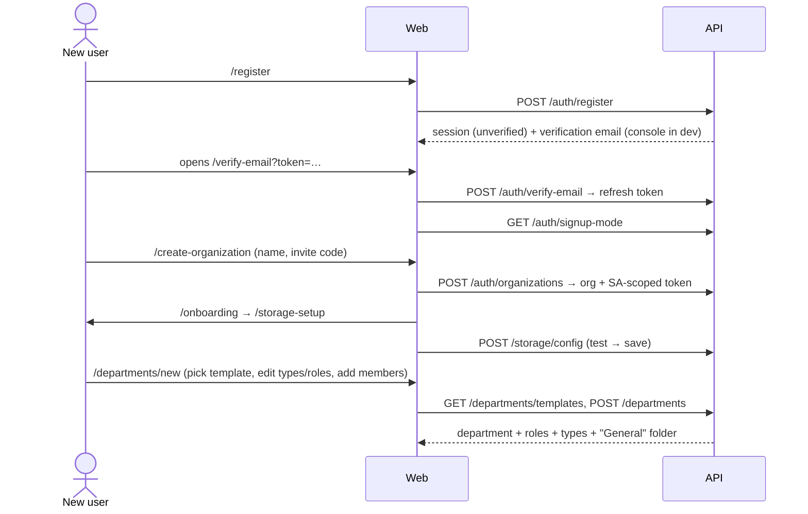
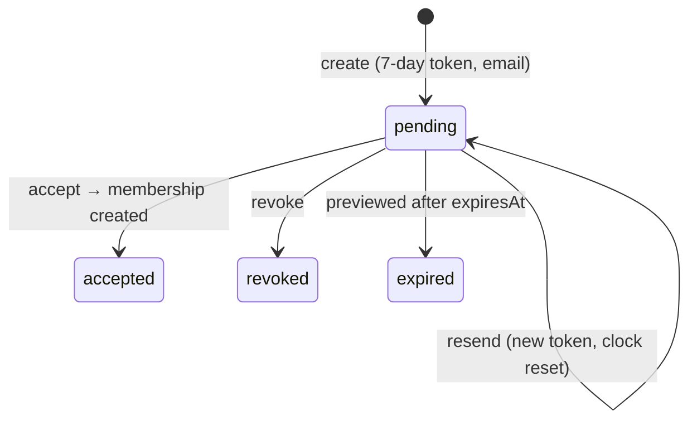
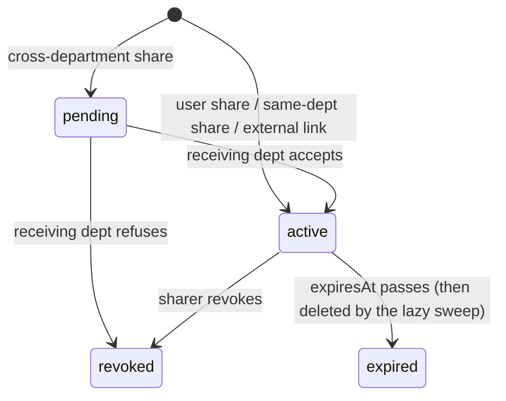
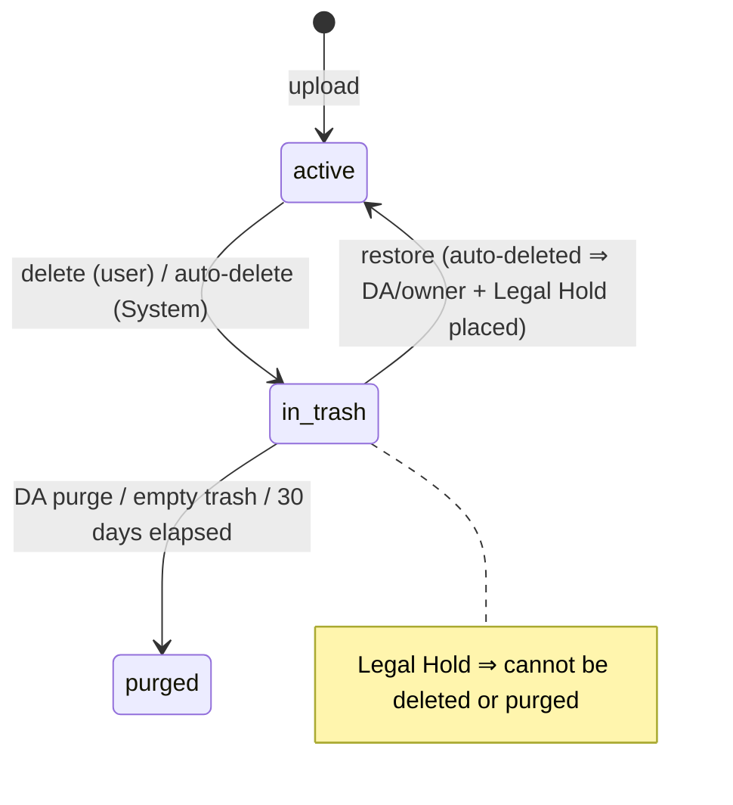
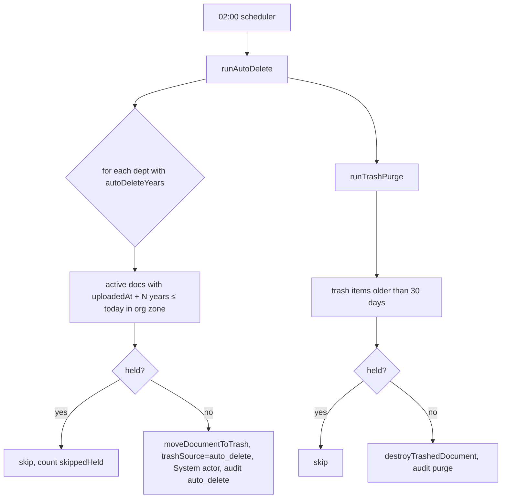

# 06 — End-to-end workflows

How each feature flows across the UI, the API, the database and the workers. Screens are named after their
files in `frontend/src/pages` / `components`. Requirement IDs (PRD) are in brackets.

---

## 1. Onboarding a new organization



After this the Super Admin lands on `DashboardPage` ("/"); everyone else lands in their first department's
workspace (`WorkspaceRedirect`).

## 2. Bringing people in

Two ways:

1. **Add an existing org user** — `DepartmentDetailPage` → `GET /departments/:id/addable-members` →
   `POST /departments/:id/members { userId, roleId }`.
2. **Invite by email** (`members.invite`) — `POST /departments/:id/invitations`. The recipient opens
   `/invitations/:token` (`AcceptInvitationPage`):
   - `GET /invitations/:token` → `hasAccount`?
   - **has account** → sign in as that email, then `POST /invitations/:token/accept` with the Bearer token.
   - **new** → enters name + password → `POST …/accept` creates a verified account + session.



Every grant respects "can't hand out more than you hold" (`canGrantRole`).

## 3. Upload → OCR → search

```mermaid
sequenceDiagram
  actor U as Member
  participant W as UploadPanel
  participant A as API
  participant S as Storage (R2/NAS)
  participant Q as Redis 'ocr'
  participant O as OCR worker
  U->>W: choose folder, type, shared metadata, files
  loop each file (sequential)
    W->>A: POST /departments/:d/folders/:f/documents/upload (multipart)
    A->>A: slot · folder∈dept · size · content check · SHA-256
    alt duplicate in dept and no choice
      A-->>W: 409 duplicate_detected {duplicates}
      U->>W: new version / keep both / skip
      W->>A: re-send with onDuplicate
    end
    A->>S: put(<org>/<uuid>, bytes)
    A->>A: tx: documentRef + document + version 1 + field values; search vector
    A->>Q: enqueue {versionId} (best-effort)
    A-->>W: 201 {action, document}
  end
  O->>Q: take job
  O->>S: get(storageRef)
  O->>O: pdf-parse (PDF) / Tesseract (image, only if OCR_IMAGES_ENABLED)
  O->>A: (DB) version.ocrText, ocrStatus=done; refresh search vector
```

Rules worth remembering:
- **Never blocks on metadata** [UPL-5]: missing required fields still save; the document shows in
  *Needs details* (`NeedsDetailsPanel`, `GET …/documents/needs-details`) until completed via
  `PATCH /documents/:id/metadata`.
- **Duplicates** [UPL-4] are detected by checksum among documents the uploader can view in that department.
- **OCR failure degrades**, never blocks [UPL-6]: `ocrStatus = failed`, metadata search still works.
- **Document ID** `DEPT-TYPE-YYYY-NNNNN` [DOC-1] is minted inside the create transaction.

Search (`DepartmentWorkspacePage` search box + `SearchFilterPanel`) → `POST /departments/:d/search`.
Paste an exact ID → `GET /documents/lookup?ref=` jumps straight to the document [DOC-3].

## 4. Viewing, downloading, versions

`DocumentViewerPage` → `GET /documents/:id` (logs `view`), then the preview bytes through
`GET /documents/:id/file?versionId=` fetched as a blob (an `<iframe>`/`` can't send the Bearer header).

- Toolbar buttons come from `document.permissions` (permission-driven UI [VUE-5]).
- Download → `?download=1` (logged `download`).
- **New version** → `POST /documents/:id/versions/upload` — new row, becomes current; ID and metadata unchanged [DOC-4].
- **Restore version** → `POST /documents/:id/versions/:vid/restore` — copies forward as a new version [DOC-5].
- After an action the page updates from the action's response and re-fetches only `…/activity`, so no
  phantom `view` events are logged.

## 5. Sharing



- `ShareDialog` (from the viewer): internal zone (a person, any department) and external zone (link).
- Recipients see it in **Shared with me** (`SharesList`, workspace quick view or `/shares`); open it with the
  read-only floor [SHR-2].
- **External link** [SHR-4/5]: `linkUrl` is shown once; the visitor opens `/l/:token` (`ExternalLinkPage`) →
  `GET /links/:token` + `GET /links/:token/file`. Every open re-validates (chapter 04 §7). Opens are counted.
- Sharer manages everything in **Shared by me** (change permission/expiry, revoke) [SHR-6].

## 6. Confidential vaults

1. Create: new-folder dialog with "Confidential" + named people → `POST …/folders { isConfidential: true, memberUserIds }`.
2. The vault and its subtree vanish for everyone else (listings, search, counts by name).
3. The owner manages access via `ConfidentialManageDialog` (`/folders/:id/confidential/members`).
4. If every member leaves (orphaned): a Super Admin or Department Admin starts recovery in
   `ConfidentialRecoveryDialog` → the *other* authority approves → the nominee becomes owner [CNF-4].

## 7. Trash, restore, purge



`TrashList` (workspace quick view "Trash", `documents.restore`) shows who deleted, the origin folder, the reason,
the auto-remove countdown and hold state. Purge deletes the file bytes through the driver and all document rows;
the audit trail survives with `documentId = NULL`.

## 8. Retention and Legal Hold (PRD v1.2)

Configured in `DepartmentDetailPage` → **Retention** tab (`RetentionPanel`):

1. **Set the period** (whole years). Setting/shortening shows "N documents will be moved to Trash at the next
   daily run" and needs confirmation (`409 confirmation_required` → re-send with `confirm: true`) [RET-7].
2. **Upcoming deletions** — next 30 days, with hold controls [RET-4].
3. **Legal Holds** — list, place on a document (viewer) or folder (workspace folder menu), remove [RET-5].

The daily run (`retention-worker`, 02:00 Asia/Kolkata):



Both steps are idempotent and isolate per-document failures. Removing a hold never deletes anything immediately
— the next run picks the document up [RET-6].

## 9. Folder permission overrides

Workspace folder menu → **Permissions** (`FolderPermissionsDialog`, `configuration.edit_rules`): pick a role,
untick what it may **not** do here. `PUT …/folders/:id/permissions/:roleId { restrict }`. Applies to the folder
and everything under it; resolution re-walks the live chain, so moving a folder re-applies overrides from its
new position [FLD-3/4].

## 10. Audit

`/w/:departmentId/audit` (`AuditPage`, `audit.view_audit`): filter by person (or "System"), action, document
text, date range → `GET …/audit`. Export CSV if `canExport` → `GET …/audit/export` [AUD-2/4]. Confidential
events appear only for `audit.view_confidential_audit` holders [AUD-5].

## 11. Organization administration (Super Admin)

| Screen | Does |
|---|---|
| `DashboardPage` | Counts per department, storage status (`/organizations/current/dashboard`) |
| `OrganizationSettingsPage` | Name, industry, default depth, **time zone** |
| `UserDirectoryPage` | Everyone, their departments/roles; disable/enable; trigger password reset; pending invitations |
| `StorageSetupPage` | Connect / re-test storage |
| `DepartmentsPage` / `DepartmentCreatePage` / `DepartmentDetailPage` | Create and configure departments (types, roles, members, rules, retention) |
| `SharesPage` | The Super Admin's own shares (they have no workspace) |
