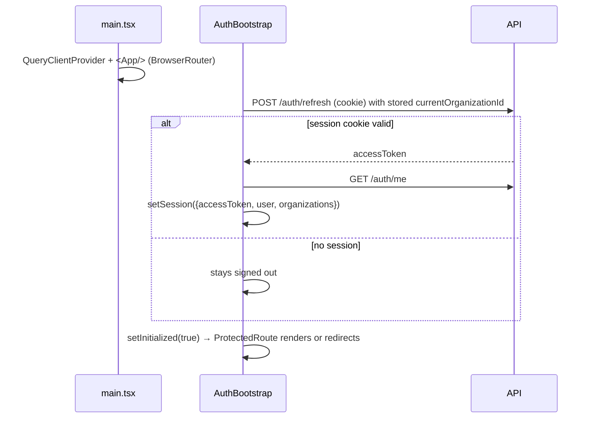

# 07 — Frontend

React 19 + TypeScript + Vite SPA in `frontend/`. Server state with **TanStack Query**, session state with
**Zustand**, routing with **React Router 7**, styling with **Tailwind 3**. No component library — the UI kit is
hand-built (`components/AuthCard.tsx`, `Select.tsx`, `DateRangePicker.tsx`, `icons.tsx`).

## 1. Boot sequence

## 2. Session state — `store/authStore.ts`

| Field | Meaning |
|---|---|
| `accessToken` | The JWT, **memory only** (never localStorage). |
| `user` | `{ id, email, fullName, emailVerified }` |
| `organizations` | `[{ id, name, isSuperAdmin }]` from login / `me` |
| `currentOrganizationId` | Persisted in `localStorage["dms:currentOrganizationId"]` so a reload re-scopes the refresh. |
| `initialized` | Boot finished. |
| actions | `setSession`, `setAccessToken`, `setUser`, `setOrganizations`, `selectOrganization(id)`, `setInitialized`, `clear()` |

`isSuperAdmin` for the current org is read from `organizations`. It only drives which screens are offered — the
server decides everything.

## 3. The API client — `lib/api.ts`

- `apiRequest<T>(path, init)` adds `Authorization: Bearer <token>`, `credentials: "include"` and JSON headers,
  then parses JSON or throws `ApiRequestError(status, code, message, details)`.
- On **401** for a non-`/auth/` path it calls `refreshAccessToken()` **once** (a single in-flight promise is
  shared, so parallel 401s trigger one refresh), stores the new token and retries.
- `refreshAccessToken()` sends the stored `currentOrganizationId`.
- Domain wrappers live next to it — one file per backend area, each exporting typed functions and the response
  interfaces (these interfaces are the de-facto response contracts; keep them in sync with the services):

| File | Wraps |
|---|---|
| `lib/departments.ts` | templates, departments, catalogue, addable members (+ `DepartmentDetail`, `DraftRole`, …) |
| `lib/folders.ts` | folders, my-permissions, rename/move/delete, overrides (+ `FolderNode`, `MyPermissions`) |
| `lib/documents.ts` | list, detail, metadata, versions, trash, purge, upload (multipart via `fetch`), file blobs |
| `lib/search.ts` | search (+ `SearchParams`, `SearchFilter`, `QuickView`) |
| `lib/sharing.ts` | shares, org users, external link open (no auth) |
| `lib/confidential.ts` | vault members, orphaned vaults, recoveries |
| `lib/retention.ts` | auto-delete setting/preview/save, upcoming, holds |
| `lib/invitations.ts` | department + org invitations, preview, accept |
| `lib/audit.ts` | audit list + export URL building |

Some pages call `apiRequest` directly for small, page-local calls (auth pages, org settings, user directory,
department detail saves).

Errors: show `err.message` (written for users); branch on `err.code`. `err.details` holds field errors
(`validation_error`), duplicate matches, or the retention preview.

## 4. Routing — `App.tsx`

`ProtectedRoute` props: signed-in (always), `requireVerified` (→ `/verify-email-pending`), `requireOrganization`
(→ `/create-organization` if no orgs, else `/select-organization`).

| Path | Page | Guard | Main API calls |
|---|---|---|---|
| `/register` | `RegisterPage` | public | `POST /auth/register` |
| `/login` | `LoginPage` | public | `POST /auth/login`, `select-organization` |
| `/verify-email` | `VerifyEmailPage` | public | `POST /auth/verify-email` |
| `/verify-email-pending` | `VerifyEmailPendingPage` | signed in | `POST /auth/resend-verification` |
| `/forgot-password`, `/reset-password` | … | public | `forgot-password`, `reset-password` |
| `/invitations/:token` | `AcceptInvitationPage` | public | preview, accept |
| `/l/:token` | `ExternalLinkPage` | public | `/links/:token`, `/links/:token/file` |
| `/create-organization` | `CreateOrganizationPage` | signed in | `signup-mode`, `POST /auth/organizations` |
| `/select-organization` | `SelectOrganizationPage` | signed in | `select-organization` |
| `/onboarding` | `OnboardingPage` | verified + org | checklist (storage, departments) |
| `/storage-setup` | `StorageSetupPage` → `StorageConnectionForm` | verified + org | `/storage/config(*)` |
| `/organization-settings` | `OrganizationSettingsPage` | verified + org | `PATCH /organizations/current` |
| `/user-directory` | `UserDirectoryPage` | verified + org | members, invitations, enable/disable, reset |
| `/` | `LandingRoute`: SA → `DashboardPage`; others → `WorkspaceRedirect` | verified + org | dashboard / departments |
| `/departments` | `DepartmentsPage` | verified + org | `GET /departments` |
| `/departments/new` | `DepartmentCreatePage` | verified + org | templates, catalogue, `POST /departments` |
| `/departments/:departmentId` | `DepartmentDetailPage` (tabs: types, roles, members, rules, retention) | verified + org | department, roles, members, invitations, retention |
| `/w/:departmentId` and `/w/:departmentId/f/:folderId` | `DepartmentWorkspacePage` | verified + org | folders, documents, my-permissions, search, trash, shares, needs-details |
| `/w/:departmentId/audit` | `AuditPage` | verified + org | audit, export |
| `/documents/:documentId` | `DocumentViewerPage` | verified + org | detail, file, activity, metadata, versions, share, hold |
| `/shares` | `SharesPage` | verified + org | with-me, by-me |
| `*` | redirect to `/` | | |

## 5. Major screens and components

| Component | Role |
|---|---|
| `AppShell` | Page chrome for admin pages (dark green rail + content). |
| `WorkspaceShell` | The department workspace frame: folder tree, quick views (Recent, Uploaded by me, Shared with me/by me, Trash), search bar. |
| `DepartmentWorkspacePage` (largest file) | Folder browser, document table, search results panel, folder actions (new, rename, move, delete, permissions, confidential, legal hold), upload entry. |
| `UploadPanel` + `MetadataFields` | Batch upload: destination folder, one type per batch (no default when the department has more than one type; the drop zone is locked until a type is chosen), shared fields, per-file title; sequential uploads; duplicate resolution prompt. Forms generated from `field_def`; a dropdown with more than 20 options renders as `SearchSelect`. |
| `NeedsDetailsPanel` | Complete metadata of incomplete uploads. |
| `SearchFilterPanel` | Filters generated from the chosen type's filterable fields (text→contains, dropdown→chips up to 20 options / `MultiSearchSelect` above 20, date→range, number→range) + Upload Date range. |
| `DocumentViewerPage` | Preview (`iframe`/`img` from a blob URL; Markdown and plain text fetched as text), details, version history, activity, Legal Hold section; actions gated by `document.permissions`. |
| `MarkdownView` | Safe Markdown renderer (`react-markdown` 10 + `remark-gfm` 4): raw HTML dropped (`skipHtml`), `javascript:`-style URLs neutralised, **images never auto-loaded** (shown as links), external links `noopener noreferrer`. Used by the viewer and the external-link page through `LazyMarkdownView`, which loads it as a separate chunk (~60 kB gzipped) only when a Markdown file is opened. Never add `rehype-raw`. |
| `ShareDialog`, `SharesList` | Create/manage shares; internal and external zones visually separate. The internal recipient is a `SearchSelect` (search by name or email). |
| `TrashList` | Trash with restore, purge, empty (DA), countdown, hold badges. |
| `FolderPermissionsDialog` | Restrict a role on a folder (only shows what the role has). |
| `MoveFolderDialog` | Destination picker; invalid destinations disabled with the reason. |
| `ConfidentialDialogs` | `PeoplePicker`, `ConfidentialManageDialog` (owner-only edits), `ConfidentialRecoveryDialog`. |
| `LegalHold` | `LegalHoldBadge` (amber, "held" / "inherited"), `PlaceHoldDialog` (reason required). |
| `department/DocumentTypeEditor` | Types + fields editor with client-side validation mirroring the server. |
| `department/RoleMatrixEditor` | Permission matrix; ticks parents automatically; marks R2 keys inactive; `isDepartmentAdminRole` mirrors `DEPARTMENT_ADMIN_CAPABILITY_KEYS`. |
| `department/RulesEditor` | Default sharing rules. |
| `department/RetentionPanel` | Auto-delete period (with confirm), upcoming deletions, holds. |
| `StorageConnectionForm` | Report-first view when connected; replace behind a warning. |
| `Select`, `DateRangePicker` | Custom listbox and date-range picker (consistent styling across browsers). |
| `SearchSelect`, `MultiSearchSelect` (`SearchableSelect.tsx`) | Long-list pickers: a search box in the menu; every typed word must appear in the label or hint. Single pick (optional "Clear selection") and multi-tick (chips under the trigger, Clear/Done footer). Used for people pickers (share recipient, department "add existing member") and dropdown fields with more than 20 options. |
| `AccountFooter` | Name, email, org switcher (only if >1 org), sign out. |

## 6. Conventions

- **Server state = TanStack Query.** Query keys are flat arrays starting with a domain name
  (`["document", id]`, `["folders", departmentId]`, `["my-permissions", departmentId, folderId]`,
  `["search", …]`, `["trash", …]`, `["shared-with-me"]`, …). After a mutation, invalidate the affected keys or
  `setQueryData` from the mutation's response. The viewer deliberately updates from responses rather than
  re-fetching `GET /documents/:id` (which would log another view).
- **Permission-driven UI.** Fetch `GET /departments/:id/my-permissions?folderId=` (or use
  `document.permissions` in the viewer) and **don't render** controls the user can't use (Feature Spec §10B) —
  but never rely on hiding for security; the server enforces everything.
- **File bytes** are fetched with `fetch` + the Bearer header into a blob URL (revoke on unmount); never put a
  protected URL directly in `src`. Text formats (`isPreviewable` → `"markdown" | "text"`) are fetched as text
  (`fetchPreviewText`) and rendered by `MarkdownView` or a `<pre>`.
- **Accepted upload types** come from `ACCEPTED_UPLOAD_EXTENSIONS` / `ACCEPTED_UPLOAD_ACCEPT` in
  `lib/documents.ts` — keep them equal to the server's `ACCEPTED_FORMATS`.
- **Errors**: surface `ApiRequestError.message`; inline next to the control that caused it.
- **Types**: keep the `lib/*.ts` interfaces equal to what the backend returns (nullable where the API can return
  null — e.g. `DocumentDetail.folderId` is null for share recipients).

## 7. Visual design system

Tokens are in `tailwind.config.*`. The rules the product owner set (keep them):

- **Palette**: emerald on cool white, anchored by a **dark green rail** (`rail` `#0A211D`). Primary `#0F6B52`
  used sparingly — active tab rule, checkboxes, selected-row edge, **one primary button per screen**. Canvas
  `#F7F8F7`, cards white, hairlines `#E4E7E5`, ink `#0F172A`. Warning amber (Legal Hold), danger red.
- **Categorical tints** (`cat-teal/green/orange/indigo`) tint document-type and template icons **only** — never
  state.
- **Type one step larger than typical**: body 15 px, inputs 15 px in ~44 px fields, page titles 30 px, section
  titles 20 px, labels 13.5 px medium. Fonts: **Inter** (UI) and **JetBrains Mono** (identifiers like document IDs).
- New UI must look premium and professional (CLAUDE.md). When in doubt, match the existing screens; a new visual
  direction needs the owner's reference image first.

## 8. Building

`npm run build --workspace frontend` = `tsc -b && vite build` → `frontend/dist`. The Docker image
(`frontend/Dockerfile`) builds with `VITE_API_URL=/api` and serves `dist` from Caddy with SPA fallback
(`try_files {path} /index.html`) and long-lived caching for `/assets/*`.
